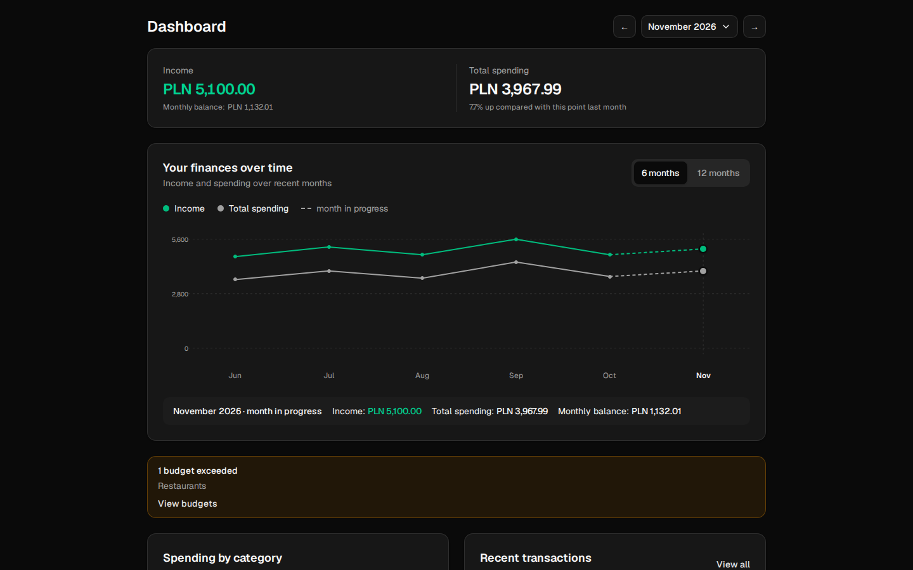
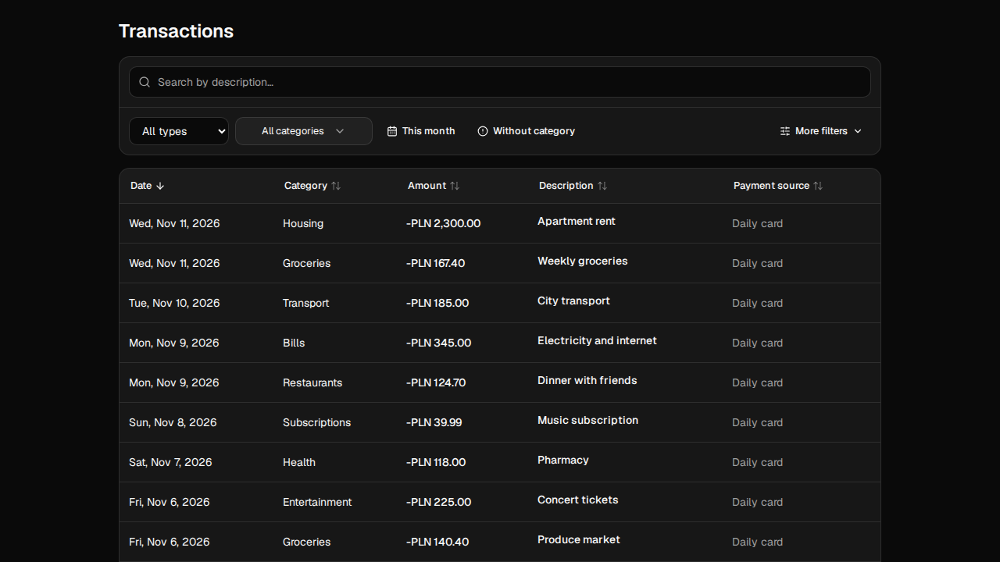
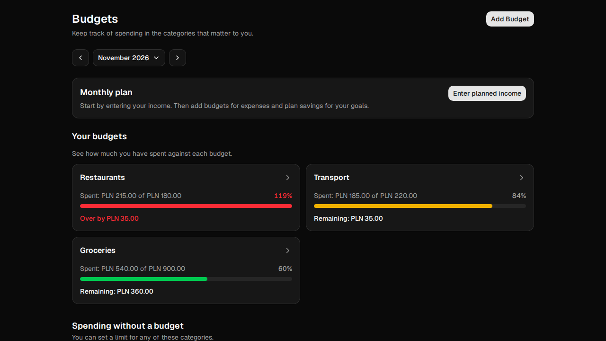
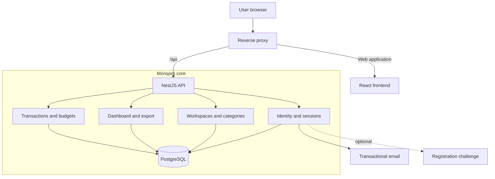

<div align="center">

# 💸 Monqom

### Personal finance, made clear.

An open-source personal finance app for understanding everyday spending, without the complexity of accounting software.

[🌐 Try Monqom](https://monqom.sergiusz.dev) · [🐳 Self-host it](docs/self-hosting.md) · [🛡️ Security](SECURITY.md) · [📜 AGPL-3.0](LICENSE)

</div>

<div align="center">
  
</div>

## ✨ Features

Looking for user guides? Visit the [Monqom Help Center](https://monqom.sergiusz.dev/help/).

|     | What you get                                                                                                               |
| --- | -------------------------------------------------------------------------------------------------------------------------- |
| 📊  | **A calm monthly overview:** totals, category breakdowns, spending trends, and recent activity in one place.              |
| 🧾  | **Organized transactions:** categories, payment sources, notes, search, and filters.                                      |
| 🎯  | **Practical budgets:** set monthly category limits and see how close you are to each one.                                 |
| 💰  | **Savings goals:** plan what you are saving for and follow your progress.                                                 |
| 🔐  | **Control over your data:** export transactions as CSV or JSON, use the hosted app, or run the open-source core yourself. |
| 🌗  | **Comfortable everywhere:** responsive layouts, dark and light themes, Polish and English.                                |

External clients can import transactions through the [integration API](docs/integration-client-guide.md).

## 👀 A quick tour

<div align="center">
  <h3>🧾 Keep everyday spending organized</h3>
  <p>Find the detail behind each expense with filters, categories, and payment sources.</p>
  
</div>

<div align="center">
  <h3>🎯 See where each budget stands</h3>
  <p>Give categories a monthly boundary and spot what needs attention before the month ends.</p>
  
</div>

<sub>All values and names shown above are fictional, deterministic presentation data.</sub>

## 🧭 Choose how you use it

- **Hosted:** create an account at [monqom.sergiusz.dev](https://monqom.sergiusz.dev) and start tracking.
- **Self-hosted:** run the open-source core with Docker and PostgreSQL on infrastructure you control. See the [self-hosting guide](docs/self-hosting.md).

## 🏗️ How it is built

Monqom is a modular monolith: one backend with clearly separated financial domains. It is straightforward to run locally or self-host, without making a personal-finance app needlessly distributed.



Financial operations are scoped to a workspace before reaching PostgreSQL. Production account
registration and password recovery require transactional email; registration protection with
Turnstile is optional.

## 🛠️ Tech stack

- **Frontend:** React, TypeScript, Vite, Tailwind CSS
- **Backend:** NestJS, Prisma, PostgreSQL
- **Quality:** Playwright, Vitest, Jest
- **Deployment:** Docker

## 🚀 Run locally

Install Docker with Compose, then create a local environment file from the example and
replace its placeholder values with local-only credentials and secrets:

```bash
cp .env.example .env
```

Start the local frontend, backend, and PostgreSQL stack:

```bash
docker compose -f docker-compose.dev.yml up --build
```

Open the app at `http://localhost:5173`. By default, the API listens on `localhost:3000`
and PostgreSQL on `localhost:5432`. The API health check is at `http://localhost:3000/health`.
The backend applies database migrations on startup.

Stop the stack when you are finished:

```bash
docker compose -f docker-compose.dev.yml down
```

Stopping the stack keeps the database volume. For development setup and checks, see
[CONTRIBUTING.md](CONTRIBUTING.md). For production configuration, see the
[self-hosting guide](docs/self-hosting.md).

## 📸 Recreate the presentation screenshots

Install dependencies first with `pnpm install --frozen-lockfile`. The generator requires Docker
with Compose and a free local port 5179. Playwright and Chromium run in a disposable container,
so no browser installation on the host is needed. Run every scenario or select only the ones you need:

```sh
pnpm run screenshots
pnpm run screenshots -- dashboard
pnpm run screenshots -- dashboard budgets transaction-form
```

Available scenarios are `dashboard`, `transactions`, `transaction-form`, `budgets`, `goals`, `help-goals`, `help-plan`, `help-review`, `help-budget-guide`, `help-transaction-guide`, and `help-plan-details`. One command starts the disposable Compose project and seeds its separate PostgreSQL database once, runs the selected scenarios in the same Playwright process, and removes the containers and volumes afterward. Each selected scenario captures both languages and themes. Port 5179 must be available. Images are updated only after every selected scenario passes; unselected images are kept. Review the generated images before committing them.

To add a documentation scenario, add a Playwright test in `frontend/screenshots/` with a unique `@scenario-id` in its title, capture each desired step with `page.screenshot({ path: resolve(output, "filename.png") })`, and add that ID to the scenario list in `scripts/screenshots.sh`. A single test can navigate through a multi-step flow and capture several checkpoints while reusing the same logged-in page. Use the `locale` fixture and run the scenario once per `en` and `pl`, as the existing tests do. Capture both themes when the screen is part of the public product set.

## 🤝 Contributing and releases

Read [CONTRIBUTING.md](CONTRIBUTING.md) and [SECURITY.md](SECURITY.md) before contributing.
See [GitHub Releases](https://github.com/sergiusz-x/monqom/releases) for release notes and the
[release checklist](docs/release-checklist.md) for deployment checks.

<div align="center">

Made for a clearer view of everyday money. · Licensed under [AGPL-3.0](LICENSE).

</div>
